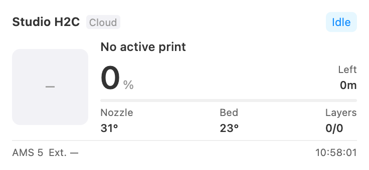
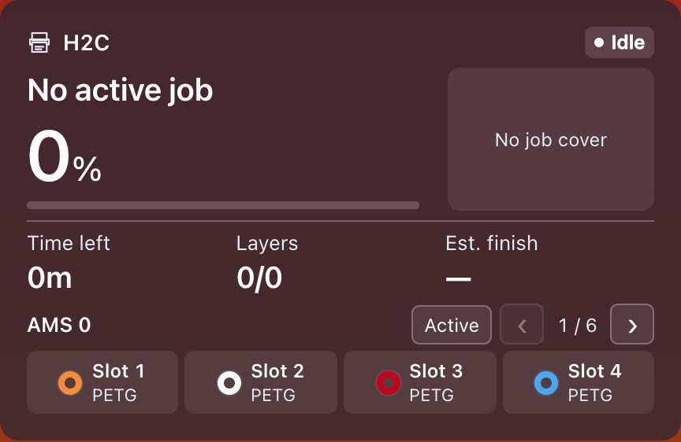

# Bambu 3DPrint Dashboard · eWeLink CUBE Add-on

See your Bambu Lab H2C on your eWeLink CUBE dashboard. Open the overview for temperatures and materials, or add one resizable card to CAST to follow a print from another screen.

在 eWeLink CUBE 上查看拓竹 H2C 的状态、温度和耗材。把一张打印卡加到 CAST，就可以给平板和手机分别选尺寸，显示任务进度、封面或 AMS 料槽。

[English](#english) · [简体中文](#简体中文) · [Docker Hub](https://hub.docker.com/r/byteandscrew/ewelink-cube-addon-bambu-3dprint-dashboard) · [Changelog / 更新记录](CHANGELOG.md)

  
  

## English

The add-on monitors one printer over Bambu Cloud. The CUBE overview opens a detail view with temperatures and AMS inventory. CAST uses the same printer connection and offers nine sizes under one card entry. The web interface and card support English and Simplified Chinese.

### Install on CUBE

1. In **Docker / Add-on**, search for `byteandscrew/ewelink-cube-addon-bambu-3dprint-dashboard`. Select `latest`, or pin `0.2.2`. The image supports Linux ARM64 and AMD64.
2. Choose **bridge** networking. Set **host port** to `3033` and **container port** to `3030/tcp`. Mount a dedicated volume at `/app/data` and start the add-on. Keep this volume when upgrading.
3. On your home network, open `http://<CUBE_IP>:3033`, replacing `<CUBE_IP>` with your gateway’s address. Choose **Account & devices**, sign in to Bambu Lab and select your printer. The first verified Bambu account manages this installation.
4. Open **CAST settings**. If the add-on runs on CUBE with the ports above, enter `http://<CUBE_IP>` for **CUBE address** and `http://<CUBE_IP>:3033` for **Card service address**. Click **Connect CUBE**, approve the request in the CUBE console, then return to the add-on and click **Connect CUBE** again. Once connected, choose **Save & sync cards**.
5. Edit a CAST panel in CUBE and select **H2C · Print Dashboard**. Pick **Pad** or **Phone**, click the tile’s bottom-right corner to cycle sizes, and drag the tile to position it. Save and open the panel at `http://<CUBE_IP>/cast/`. Pad and Phone each keep their own layout.

The add-on keeps cloud session tokens and the selected printer in the private data volume. Passwords and verification codes are discarded after sign-in.

Moving the add-on from another computer? An existing card can still point to the old host. Check both addresses in CAST settings and record the card’s position and size before replacing it. [Installation and migration guide](docs/INSTALL.md#english)

### Choose a CAST size

| Grid | What fits |
| --- | --- |
| 2×2 · 4×1 | Status, job name, progress and time left, as a square or a strip |
| 4×2 | Adds current and total layers |
| 4×3 · 6×3 | Adds the job cover and estimated finish time |
| 6×2 | A wide cover layout with progress, time left and layers |
| 4×4 | Job cover, time estimates and current filament |
| 6×4 | Job overview plus an AMS browser showing one unit at a time |
| 6×6 | The 6×4 view plus print stage and nozzle, bed and chamber temperatures |

The initial size is **2×2**. On **6×4** and **6×6**, use the arrows to page through AMS units and the reported external spool. Your selected page stays in place as data updates. Choose **Active** to return to the active spool when the printer reports one. [View the English 6×6 card with live idle data](docs/images/cast-live-6x6-022-en.png)

### Tested setup

Version **0.2.2** was installed on **CUBE OS 2.15.0**. Bambu sign-in, printer selection, CUBE authorization and CAST playback were verified with a real H2C at idle. Its cloud data reported five AMS units and fourteen slot entries. All nine registered CAST pages, both CUBE card sizes and the detail page loaded. Verification during an active print is still pending for job covers, finish estimates and material changes. H2C is the model tested so far.

To try it locally, run `npm ci` then `npm start` with Node.js 24.12 or later and open `http://127.0.0.1:3030`. The local demo uses synthetic data. Run `npm run typecheck` and `npm test` for development checks.

### License

Original code and documentation use the MIT license. The protocol mapping and cloud sign-in portions adapted from PrintSphere retain FNCL v1.1, which requires separate upstream permission for commercial use. This is an independent community project. [MIT license](LICENSE) · [Attribution and license scope](NOTICE.md) · [PrintSphere](https://github.com/cptkirki/PrintSphere)

## 简体中文

插件通过拓竹云端只读监控一台打印机。在 CUBE 首页点综合卡，可以查看温度和 AMS 耗材详情。CAST 共用同一条打印机连接，添加一张卡即可使用九种尺寸。管理界面和卡片均支持简体中文与英文。

### 在 CUBE 上安装

1. 在 **Docker／Add-on** 中搜索 `byteandscrew/ewelink-cube-addon-bambu-3dprint-dashboard`，选择 `latest`，也可以指定 `0.2.2`。镜像支持 Linux ARM64 和 AMD64。
2. 网络选 **bridge（桥接）**，**主机端口**填 `3033`，**容器端口**填 `3030/tcp`。给 `/app/data` 挂载一个专用数据卷，然后启动。以后升级时沿用这个卷即可保留配置。
3. 在家庭局域网打开 `http://<CUBE_IP>:3033`，把 `<CUBE_IP>` 换成平时打开 CUBE 控制台用的地址。点 **账号与设备**，登录拓竹并选择打印机。首次验证成功的拓竹账号会成为该插件的管理账号。
4. 打开 **CAST 配置**。按上面的端口安装时，**CUBE 地址**填 `http://<CUBE_IP>`，**卡片服务地址**填 `http://<CUBE_IP>:3033`。点 **连接 CUBE**，到 CUBE 控制台确认授权，再回插件点一次 **连接 CUBE**。看到已连接后，点 **保存并同步卡片**。
5. 在 CUBE 的 CAST 面板编辑器中勾选 **H2C · Print Dashboard**。选 **Pad** 或 **Phone**，点卡片右下角切换尺寸，拖动卡片主体调整位置。保存后打开 `http://<CUBE_IP>/cast/` 进入面板。平板和手机分别保存各自的布局。

云端会话令牌和选机信息保存在专用数据卷中。密码和验证码仅用于本次登录。

如果原来在另一台电脑上运行插件，旧卡可能还指向那台电脑。先核对 CAST 配置里的两个地址，记下旧卡在面板中的尺寸和位置，再按指南替换。[安装与旧卡迁移说明](docs/INSTALL.md#简体中文)

### CAST 尺寸怎么选

| 网格 | 展示内容 |
| --- | --- |
| 2×2、4×1 | 方卡或横条，显示状态、任务名称、进度和剩余时间 |
| 4×2 | 增加当前层数和总层数 |
| 4×3、6×3 | 增加任务封面和预计结束时间 |
| 6×2 | 横向排列封面、进度、剩余时间和层数 |
| 4×4 | 显示封面、时间和当前耗材 |
| 6×4 | 任务概览加 AMS 翻页，每页显示一个耗材单元 |
| 6×6 | 在 6×4 基础上增加打印阶段，以及喷嘴、热床和腔体温度 |

默认尺寸为 **2×2**。在 **6×4** 和 **6×6** 上，可以用箭头切换 AMS；设备报告的外置料盘也会单独占一页。数据刷新时会保留当前页。设备报告正在使用的料槽时，点 **当前** 可跳回该料槽。[查看 6×6 英文版实机待机卡片](docs/images/cast-live-6x6-022-en.png)

### 实测情况

**0.2.2** 已在 **CUBE OS 2.15.0** 上安装，并用真实 H2C 验证了拓竹登录、选机、CUBE 授权和 CAST 待机播放。测试设备上报了 5 个 AMS 单元、14 个料槽条目。九个 CAST 尺寸入口、两种 CUBE 卡片尺寸及详情页均已加载验证。实际打印中的任务封面、预计结束时间和换料变化仍待验证。目前实测机型为 H2C。

本地体验需要 Node.js 24.12 或更高版本。在项目目录依次运行 `npm ci`、`npm start`，打开 `http://127.0.0.1:3030` 即可查看演示数据。开发检查用 `npm run typecheck` 和 `npm test`。

### 许可证

原创代码与文档采用 MIT 许可证。参考 PrintSphere 改编的协议映射和云端登录部分沿用 FNCL v1.1，商业使用这些部分需要上游另行授权。本项目由社区独立开发。[MIT 许可证](LICENSE) · [署名与许可范围](NOTICE.md) · [PrintSphere 原项目](https://github.com/cptkirki/PrintSphere)
