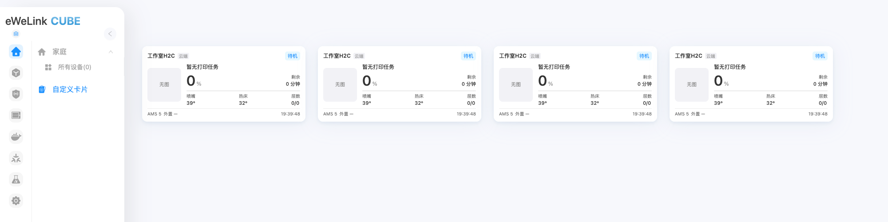
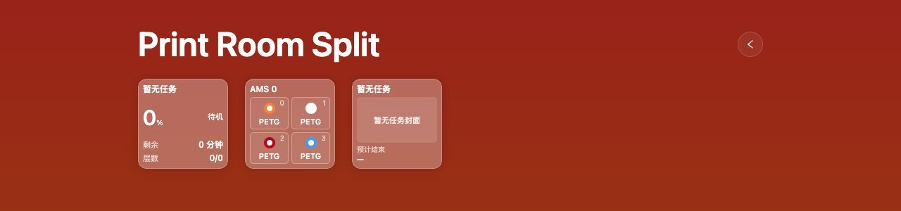
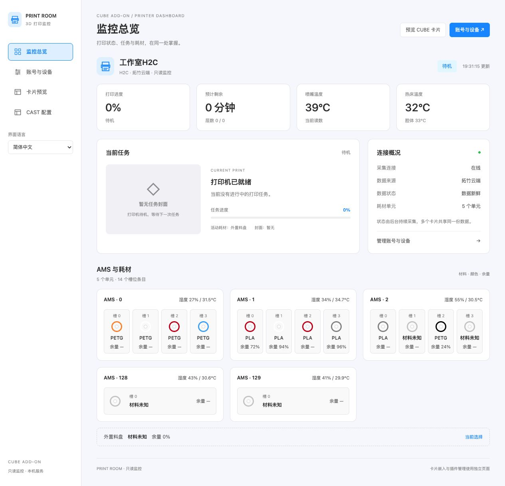
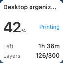
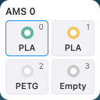
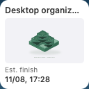
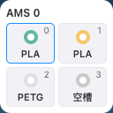
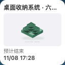

# Bambu 3DPrint Dashboard · eWeLink CUBE Add-on

**Version / 版本：0.1.0** · [Release notes / 更新说明](CHANGELOG.md)

**Your Bambu printer, on your CUBE dashboard and CAST screens.**

**把拓竹打印机的状态，带到 CUBE 卡片与 CAST 屏幕。**

[English](#english) · [简体中文](#简体中文)

## English

A read-only dashboard that connects to Bambu Lab through the cloud, collects your printer's status, and displays it in **eWeLink CUBE cards** and **CAST panels**. Manage the connection in a desktop-friendly web interface, then choose the information you want on each screen.

The current focus is **one H2C printer over the cloud**, including **AMS materials** and **current-job covers**. The interface supports English and Simplified Chinese.

### What you can see

- **Printer status** — connection, printing stage, job name, progress, time left, layers and available temperatures.
- **Materials** — AMS units and slots, material types, filament colors and the active material or external spool. Remaining material, humidity and other values appear when the data source provides them.
- **Current job** — a task-bound cover image and estimated finish time, with explicit states for missing images, unknown values and stale data.
- **CUBE views** — an overview card and a detail view, with a separate layout for constrained CAST screens.
- **Web management** — account region, cloud sign-in, printer selection, live overview, card previews and CAST configuration.

### Real CUBE and CAST screenshots

**CUBE custom cards**



**CAST panel: print status, AMS materials and job summary**



*Captured on CUBE OS 2.15.0 with real H2C cloud data while idle. The backend runs on a separate computer. The CUBE list shows the original card and three functional-card entries for the same printer. The CUBE image is cropped to the card area; displayed data is unchanged. These screenshots do not demonstrate an active print or installation inside CUBE.*

**Known limitation:** each separate CAST card currently also creates an overview entry in CUBE Custom cards. Keeping only one CUBE entry while offering several independent CAST cards is not implemented; CAST-only registration was rejected by the tested CUBE OS 2.15.0 API.

### Live web dashboard



*Captured from the actual desktop management page with real H2C cloud data while idle, including five material units. The service runs on a separate computer; this is not a screenshot of an installed CUBE add-on container.*

### Three focused CAST cards

Choose the cards you need and arrange them in CUBE. The original overview card and detail view keep their comprehensive layout.

| Print status | Materials | Job summary |
| --- | --- | --- |
|  |  |  |
| Job name, progress, time left and layers. | Follow the active material or select a fixed AMS unit or external spool. | Cover, job name and estimated finish time. |

*These are synthetic preview screenshots, not evidence of a real print. A real card's dimensions depend on the CUBE host layout.*

### How it works

```text
Bambu printer → Bambu cloud → Dashboard service → CUBE cards / CAST panels
                                   ↑
                            Web management
```

One backend connection collects the data for all views. Each card reads the same normalized status; opening more cards does not create more printer connections. The service can run in Docker, or on another computer that is reachable from the browser displaying CUBE and CAST.

### Getting started

The published test image supports **linux/arm64** and **linux/amd64**:

```sh
docker pull byteandscrew/ewelink-cube-addon-bambu-3dprint-dashboard:0.1.0-test.1
```

1. Add the image in CUBE's Docker / Add-on menu, or run it on another Docker host.
2. Configure a persistent data volume, a web port and the management origin and access key for LAN access.
3. Open the add-on's web interface, sign in to Bambu and select your printer.
4. Open **CAST settings**, choose cards and language, then connect to CUBE and sync the cards.
5. Select and arrange the new cards in your CUBE CAST panel.

See the [installation guide](docs/INSTALL.md) for settings and a Docker run example. [View the image on Docker Hub](https://hub.docker.com/r/byteandscrew/ewelink-cube-addon-bambu-3dprint-dashboard).

For a local demo without a printer, use **Node.js ≥ 24.12**:

```sh
npm ci
npm start
```

Open `http://127.0.0.1:3030`. The default demo uses clearly labeled synthetic data. For local cloud sign-in, start with `DASHBOARD_MODE=setup npm start` instead. Change the interface language from the sidebar, or use `?lang=en` / `?lang=zh-CN`. Card language can be configured independently.

### Current validation status

| Area | Status |
| --- | --- |
| H2C cloud connection | Real sign-in, printer selection, idle status, temperatures and AMS data observed. |
| CUBE OS 2.15.0 | Original cards, detail view and the three separate CAST cards observed with real idle data. |
| Docker package | ARM64 and AMD64 container startup, protected management and configuration persistence checked; test image published. |
| Still to validate | Active-print progress and covers, estimated finish time and AMS changes during a real job; installation and operation inside CUBE. |

This is an early test release. Other printer models and 32-bit ARM hosts have not been validated. Printer controls, video, automations and multi-printer management are outside the current scope. Bambu cloud authentication is required; token expiry currently requires signing in again.

GitHub source release: **0.1.0**. The Docker Hub image linked above remains the earlier **0.1.0-test.1** build; it is not an image built from this release.

### Credentials and data

Passwords and verification codes are not persisted. Cloud tokens and the selected printer are saved in the private data volume so the service can restore a session after restart. CUBE credentials stay in the backend and are not included in card URLs. Keep the data volume private and use the management access key when exposing the service to your LAN.

### Development

```sh
npm run typecheck
npm test
npm run test:browser
npm run test:cast
npm run test:i18n
```

Browser checks require Chrome or Playwright Chromium. This repository uses TypeScript, Node.js and HTML/CSS/JavaScript.

### License and acknowledgments

Original project code is offered under the standard [MIT License](LICENSE). **MIT does not replace the license of third-party or adapted code.** Protocol mapping and cloud-login portions referenced or adapted from [cptkirki/PrintSphere](https://github.com/cptkirki/PrintSphere) retain **FNCL v1.1** and its non-commercial terms. See [NOTICE](NOTICE.md) and the [retained upstream license](packages/printer-bambu/UPSTREAM_LICENSE) before reuse, especially commercial use.

This is an independent community project, with no official affiliation with Bambu Lab or eWeLink.

## 简体中文

这是一个通过拓竹云端读取打印机信息，并在 **eWeLink CUBE 自定义卡片**及 **CAST 面板**中展示的只读仪表盘。你可以在适合电脑屏幕的 Web 管理页面中完成登录、选机和卡片配置，再把需要的信息放到不同屏幕上。

当前围绕**一台 H2C 的云端连接**开发，包含 **AMS 耗材信息**和**当前任务封面**，界面支持简体中文与英文。

### 可以展示什么

- **打印状态**：连接状态、打印阶段、任务名称、进度、剩余时间、层数，以及数据源提供的温度信息。
- **耗材信息**：AMS 单元与槽位、材料类型、耗材颜色、活动耗材和外置料盘；余量、湿度等仅在取得有效数据时展示。
- **当前任务**：与任务身份绑定的封面和预计结束时间；无图、未知值、数据过期都有明确状态。
- **CUBE 视图**：综合卡片与详情页，以及适合小尺寸屏幕的独立 CAST 布局。
- **Web 管理**：账号地区、云端登录、打印机选择、监控总览、卡片预览和 CAST 配置。

### CUBE 与 CAST 真实截图

**CUBE 自定义卡片**


**CAST 面板：打印状态、AMS 耗材和任务总结**


*截图来自 CUBE OS 2.15.0，使用真实 H2C 云端待机数据，后台运行在独立电脑上。CUBE 列表展示同一台打印机的原综合卡与三张功能卡条目。CUBE 图片仅裁剪到卡片区域，未修改界面数值；以上不代表已验证实际打印任务或 CUBE 内安装。*

**已知限制：**当前每张独立 CAST 卡也会在 CUBE 自定义卡片中新增综合卡条目。“仅一张 CUBE 卡，同时提供多张独立 CAST 卡”尚未实现；实测 CUBE OS 2.15.0 接口拒绝仅 CAST 注册。

### Web 管理实测画面


*截图来自实际 Web 管理页，使用真实 H2C 云端待机数据，包含五个耗材单元。服务运行在独立电脑上，不代表已在 CUBE 内安装容器。*

### 三类独立 CAST 卡片

按需要选择卡片，再在 CUBE 中排列。原有综合卡片与详情页保留完整信息布局。

| 打印状态 | AMS 耗材 | 任务总结 |
| --- | --- | --- |
|  |  |  |
| 任务名称、进度、剩余时间和层数。 | 跟随当前耗材，或固定展示某个 AMS 单元、外置料盘。 | 封面、任务名称和预计结束时间。 |

*以上为合成数据预览截图，不代表真实打印任务已经验证。实际卡片尺寸由 CUBE 宿主布局决定。*

### 工作方式

```text
拓竹打印机 → 拓竹云端 → 仪表盘后台 → CUBE 卡片 / CAST 面板
                            ↑
                       Web 管理页面
```

后台统一采集数据，各个页面与卡片共用同一份状态，增加卡片不会重复建立打印机连接。服务可运行在 Docker 中，也可以运行在另一台能够被 CUBE／CAST 浏览器访问的电脑上。

### 快速开始

已发布的测试镜像提供 **linux/arm64** 和 **linux/amd64** 两种架构：

```sh
docker pull byteandscrew/ewelink-cube-addon-bambu-3dprint-dashboard:0.1.0-test.1
```

1. 在 CUBE 的 Docker／Add-on 菜单添加镜像，或在其他 Docker 主机运行。
2. 配置持久数据卷、Web 端口，以及局域网管理所需的访问地址与管理密钥。
3. 打开插件 Web 页面，登录拓竹账号并明确选择打印机。
4. 进入 **CAST 配置**，选择卡片和语言，连接 CUBE 后同步卡片。
5. 在 CUBE CAST 面板中选择并排列新增卡片。

具体参数与 Docker 运行示例见[安装说明](docs/INSTALL.md)。也可以[查看 Docker Hub 镜像](https://hub.docker.com/r/byteandscrew/ewelink-cube-addon-bambu-3dprint-dashboard)。

没有打印机也可以在本机体验演示，需要 **Node.js ≥ 24.12**：

```sh
npm ci
npm start
```

打开 `http://127.0.0.1:3030`。默认使用明确标注的合成数据；如需本机云端登录，改用 `DASHBOARD_MODE=setup npm start`。在侧栏切换语言，或使用 `?lang=en`／`?lang=zh-CN`；嵌入卡片语言可以独立配置。

### 当前验证情况

| 部分 | 状态 |
| --- | --- |
| H2C 云端连接 | 已观察真实登录、选机、待机状态、温度与 AMS 数据。 |
| CUBE OS 2.15.0 | 已用真实待机数据观察综合卡、详情页和三类独立 CAST 卡片。 |
| Docker 打包 | ARM64／AMD64 容器启动、管理鉴权和配置持久化检查通过，测试镜像已发布。 |
| 仍待实测 | 真实打印任务中的进度、封面、预计结束与 AMS 变化，以及 CUBE 内安装和持续运行。 |

当前是早期测试版本，尚未验证其他打印机型号或 32 位 ARM 主机。当前范围不包含打印控制、视频、自动化联动和多打印机管理。需要拓竹云端认证；令牌到期后暂需重新登录。

GitHub 源码版本为 **0.1.0**。上方 Docker Hub 镜像仍为较早的 **0.1.0-test.1** 构建，并非本次源码版本对应的镜像。

### 凭证与数据

不持久化密码和验证码。云端令牌与选机信息保存在私密数据卷中，用于服务重启后恢复会话；CUBE 凭证仅保留在后台，不写入卡片 URL。请保管好数据卷，并在局域网开放管理入口时设置管理密钥。

### 开发检查

```sh
npm run typecheck
npm test
npm run test:browser
npm run test:cast
npm run test:i18n
```

浏览器检查需要 Chrome 或 Playwright Chromium。项目使用 TypeScript、Node.js 和 HTML／CSS／JavaScript。

### 许可证与致谢

本项目独立原创代码采用标准 [MIT 许可证](LICENSE)。**MIT 不覆盖第三方或派生代码的既有许可。** 参考或改编自 [cptkirki/PrintSphere](https://github.com/cptkirki/PrintSphere) 的协议映射和云端登录部分，继续保留 **FNCL v1.1** 及其非商业使用条款；复用前，尤其是商业使用前，请阅读 [NOTICE](NOTICE.md) 与[上游许可证](packages/printer-bambu/UPSTREAM_LICENSE)。

本项目由社区独立开发，与 Bambu Lab 或 eWeLink 没有官方隶属关系。
